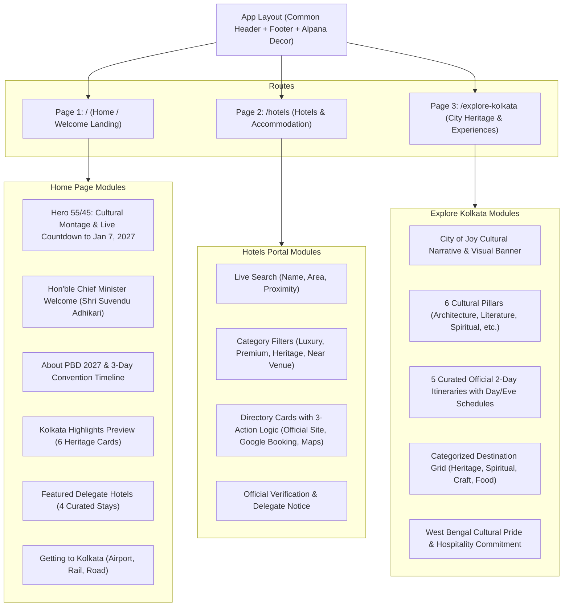

# 19th Pravasi Bharatiya Divas 2027 – Kolkata Welcome & Delegate Experience
## Master Implementation Plan & Architectural Specification

> **Event Summary**: 19th Pravasi Bharatiya Divas Convention  
> **Dates**: January 7–9, 2027  
> **Host City & Venue**: Kolkata, West Bengal | Biswa Bangla Mela Prangan  
> **Theme**: *"Return to Roots: Reigniting the Diaspora Connect with Bharat"*  
> **Design Philosophy**: Government-event grade elegance, warm ivory & saffron visual identity derived from `pbdindia.gov.in`, subtle Bengali Alpana motifs, floating floral micro-animations, and high-utility delegate services.

---

## 1. Executive Summary & Design System

The objective is to transform the existing Vite + React + TypeScript + Tailwind setup into an official-grade, culturally authentic, and high-utility visitor portal for the 19th Pravasi Bharatiya Divas Convention in Kolkata.

### 1.1 Strict Color Token System (Aligned with Official PBD)
Unlike generic dark or tech themes, the color palette strictly follows the official PBD aesthetic:
* **Primary Saffron / Burnt Orange**: `#D94B12` (CTAs, countdown highlights, badges, primary active accents)
* **Deep Maroon / Terracotta Brown**: `#63240F` (Major titles, serif headings, prestige frames)
* **Warm Pure White**: `#FFFFFF` (Card surfaces, clean reading canvas)
* **Soft Ivory / Pale Cream**: `#FAF5EF` (Primary background, section transitions)
* **Decorative Pale Peach**: `#F5E7DA` (Alpana backing, container accents, cultural badges)
* **Charcoal Text**: `#333333` / `#414141` (High-legibility typography)
* **Golden Zari Accent**: `#C89234` / `#D4A359` (Traditional ornamental trims and motifs)

*Strict rule enforced*: No blue/purple tech gradients, no dark cyberpunk themes, no saturated neon tones.

### 1.2 Typography
* **Serif Headings**: Playfair Display / Cormorant Garamond / Merriweather serif accents for cultural majesty.
* **Sans-Serif Body**: Plus Jakarta Sans / Inter for razor-sharp readability on schedules and directories.

---

## 2. Information Architecture & Three-Page Sitemap

---

## 3. Cultural Assets Integration (`banglar-durgotsav-frontend/src/assets`)

We will selectively copy and adapt the rich Bengali cultural assets from `C:\Users\santr\banglar-durgotsav-frontend\src\assets`:

| Source Asset | Target Project Location | Application in PBD Portal |
| :--- | :--- | :--- |
| `svgs/alpona.svg`, `alpona-2.svg`, `alpona-3.svg`, `alpona-btm.svg` | `src/assets/patterns/alpana/` | Background corner ornaments, section headers, CM section frame |
| `svgs/chakra.svg`, `diya.svg`, `page-end.svg` | `src/assets/patterns/decorations/` | Elegant cultural dividers between major sections |
| `alpana/hero-alpana.png`, `alpana/alpona-tree.png` | `src/assets/images/hero/` | Hero cultural montage framing |
| `flowers/1.png` through `7.png` | `src/assets/flowers/` | Subtle, lightweight floating flower petal physics in `FloatingFlowers.tsx` |
| `common/river.png` | `src/assets/images/cultural/` | Hooghly river panoramic backdrop element |

*Durga Puja specific religious icons and idol photography will be excluded* to maintain the broad, inclusive diplomatic focus of the Pravasi Bharatiya Divas convention.

---

## 4. Detailed Component Specifications

### 4.1 Global Layout & Interactive Header
* **Sticky Header**: Warm white background, thin saffron bottom border (`border-b-2 border-[#D94B12]`), soft shadow.
* **Branding**: Official PBD 2027 identity emblem + West Bengal cultural emblem + "Kolkata Welcomes the Diaspora".
* **Navigation Links**:
  - `Home` (`/`)
  - `Hotels & Stays` (`/hotels`)
  - `Explore Kolkata` (`/explore-kolkata`)
  - `#convention` (Scrolls to 3-day timeline)
  - `#cm-welcome` (Scrolls to Chief Minister message)
* **CTA Button**: Saffron gradient button linking directly to *Explore Kolkata* or *Discover Hotels*.
* **Mobile Drawer**: Responsive animated hamburger drawer with full navigation access.

### 4.2 Page 1: Home / Landing Page
1. **Hero Section (55% / 45% Split)**:
   - **Left (55%)**: Layered visual montage of Kolkata heritage (Howrah Bridge, Victoria Memorial, heritage tram, yellow taxi, Hooghly river, Rabindranath Tagore cultural motif, framed by authentic Bengali Alpana).
   - **Right (45%)**:
     - Event Badge: *19th Pravasi Bharatiya Divas 2027*
     - Headline: *Kolkata Welcomes the Global Indian Diaspora*
     - Official Theme: *"Return to Roots: Reigniting the Diaspora Connect with Bharat"*
     - Venue: *Biswa Bangla Mela Prangan, Kolkata, West Bengal*
     - Dates: *January 7–9, 2027*
     - **Live Countdown Timer**: Calculating days, hours, minutes, seconds remaining to **January 7, 2027, 09:00 AM IST (Asia/Kolkata)**.
     - Dual CTA buttons: *Explore Kolkata* & *Discover Hotels*.

2. **Chief Minister's Welcome Section**:
   - Official portrait of **Shri Suvendu Adhikari**, Hon'ble Chief Minister of West Bengal, encased in a decorative Bengali terracotta border with corner Alpana motifs.
   - Text layout on soft ivory card:
     - Title: *"A Warm Welcome to Kolkata"*
     - Salutation: *"Dear Members of the Global Indian Diaspora,"*
     - Dignified welcome copy celebrating Kolkata as India's intellectual & cultural capital.
     - Formal signature and designation.
     - Clear editorial notice: *"Proposed welcome draft pending final government protocol gazette."*

3. **About PBD & Three-Day Programme Timeline**:
   - Editorial cards explaining the history of PBD (commemorating Mahatma Gandhi's return from South Africa on Jan 9, 1915).
   - Interactive 3-Day schedule cards:
     - **Day 1 (Jan 7)**: *Youth Pravasi Bharatiya Divas* (Plenary sessions on tech, startup diaspora, and cultural exchange).
     - **Day 2 (Jan 8)**: *Grand Inauguration of 19th PBD* by Hon'ble Prime Minister of India, Keynote addresses, State exhibitions.
     - **Day 3 (Jan 9)**: *Valedictory Session & Pravasi Bharatiya Samman Awards* conferred by Hon'ble President of India.

4. **Kolkata Highlights Preview**:
   - 6 curated destination cards (Victoria Memorial, Howrah Bridge, Dakshineswar Kali Temple, Belur Math, Prinsep Ghat, Jorasanko Thakur Bari) with direct Google Maps directions.

5. **Featured Delegate Accommodation Preview**:
   - 4 featured luxury stays closest to Biswa Bangla Mela Prangan (ITC Royal Bengal, JW Marriott, Hyatt Regency, Novotel).
   - "View All Hotels" button routing to `/hotels`.

6. **Delegate Transit & Getting to Kolkata**:
   - **Air**: Netaji Subhas Chandra Bose International Airport (CCU) — 15 km to Salt Lake / New Town.
   - **Rail**: Howrah (HWH), Sealdah (SDAH), and Kolkata (KOAA) Terminus.
   - **Road & Venue Shuttles**: Transit corridors along EM Bypass and Maa Flyover.

---

### 4.3 Page 2: Hotels & Accommodation (`/hotels`)
1. **Interactive Filter & Search Header**:
   - Live text search (hotel name, area, proximity).
   - Category filter pills: `All`, `Luxury (5-Star)`, `Premium`, `Boutique / Heritage`, `Near Convention Venue`.
   - Proximity sorting prioritizing hotels closest to Biswa Bangla Mela Prangan.
2. **Hotel Directory (12+ Curated Stays)**:
   - *ITC Royal Bengal*, *JW Marriott Kolkata*, *Hyatt Regency*, *Novotel Kolkata*, *The Oberoi Grand*, *Taj Bengal*, *The Lalit Great Eastern*, *The Park Kolkata*, *Kenilworth Hotel*, *Raajkutir (IHCL SeleQtions)*, *The Westin Kolkata Rajarhat*, *Peerless Hotel*.
3. **Tri-Action Booking Logic (As Specified)**:
   - **Action 1 (Official Website)**: Verified direct URL to official hotel website.
   - **Action 2 (Find Booking Options)**: Google search link formatted as `https://www.google.com/search?q={HotelName}+Kolkata+official+booking`.
   - **Action 3 (Directions)**: Direct Google Maps link `https://www.google.com/maps/search/?api=1&query={HotelName}+Kolkata`.
4. **Mandatory Advisory Banner**:
   - Clear event disclaimer noting that the directory is an independent delegate convenience guide and that official PBD designated rates will be published upon MEA notification.

---

### 4.4 Page 3: Explore Kolkata & Curated Itineraries (`/explore-kolkata`)
1. **The Spirit of Kolkata Hero**:
   - High-resolution imagery of Kolkata’s skyline, Hooghly river, and heritage architecture.
2. **6 Cultural Pillars**:
   - *Architectural Heritage* (Colonial & Indo-Saracenic grandeur)
   - *Art & Creative Culture* (Terracotta, Patachitra, and music)
   - *Literature & Intellectual Capital* (Tagore, College Street, Coffee House)
   - *Culinary Heritage* (Mishti Doi, Rosogolla, Kolkata Biryani, Street food)
   - *Spiritual Harmony* (Belur Math, Dakshineswar, Kalighat, St. Paul's Cathedral)
   - *Modern Kolkata* (IT Hub, New Town, Biswa Bangla Convention Centre)
3. **5 Curated Official 2-Day Itineraries**:
   - *A Taste of Kolkata* (Culinary trails from College Street to Park Street)
   - *Kolkata City Heritage Walk* (BBD Bagh, General Post Office, Victoria Memorial)
   - *The Cultural & Literature Experience* (Jorasanko Thakur Bari, National Library, Academy of Fine Arts)
   - *Kolkata Spiritual Tour* (Dakshineswar Kali Temple, Belur Math ferry, Kalighat)
   - *Kolkata Shopping & Craft Trail* (New Market, Gariahat, Dakshinapan, Biswa Bangla Emporiums)
   - Each with morning, afternoon, evening timing breakdowns and Google Maps routes.
4. **Interactive Destination Filter**:
   - Filter by `Heritage`, `Spiritual`, `Nature & Riverside`, `Shopping & Crafts`, `Family & Science`.
5. **West Bengal Hospitality & Chief Minister Corner**:
   - Dedicated cultural message reaffirming the state's traditional warmth (*"Atithi Devo Bhava"*).

---

## 5. Animation & Decorative System

1. **`AlpanaBackground.tsx`**:
   - Subtle geometric and floral circular Bengali Alpana SVGs positioned at corners and section transitions with low opacity (8%–15%).
   - Slow, organic CSS rotation (120s per rotation) for a serene, living cultural feel.
2. **`FloatingFlowers.tsx`**:
   - Lightweight canvas/DOM floating petals using the PNG assets from `banglar-durgotsav-frontend/src/assets/flowers/`.
   - Non-intrusive physics with gentle swaying and vertical descent, disabled if `prefers-reduced-motion` is active.
3. **Countdown Micro-Transitions**:
   - Smooth numerical tick for Days, Hours, Minutes, Seconds until January 7, 2027.
4. **Card Hover & Stagger Effects**:
   - Gentle vertical lift (`y: -4px`) and warm amber box-shadow on cards.

---

## 6. Implementation Milestones

| Step | Task | Status |
| :--- | :--- | :--- |
| **Phase 1** | Install `react-router-dom`, set up route scaffolding & PBD color tokens in `index.css` | Ready |
| **Phase 2** | Import and organize Alpana SVGs, flower PNGs, and cultural motifs into `src/assets/` | Ready |
| **Phase 3** | Construct structured data stores: `hotels.ts`, `attractions.ts`, `itineraries.ts`, `event.ts` | Ready |
| **Phase 4** | Build reusable UI: `Header.tsx`, `Footer.tsx`, `AlpanaBackground.tsx`, `FloatingFlowers.tsx`, `Countdown.tsx` | Ready |
| **Phase 5** | Implement Page 1 (`HomePage.tsx`): Hero 55/45, CM Section, PBD Timeline, Highlights, Transit | Ready |
| **Phase 6** | Implement Page 2 (`HotelsPage.tsx`): Live search, proximity/category filters, tri-action booking logic | Ready |
| **Phase 7** | Implement Page 3 (`ExploreKolkataPage.tsx`): 6 cultural pillars, 5 curated itineraries, destination gallery | Ready |
| **Phase 8** | Verification: Test responsive design (Mobile/Tablet/Desktop), verify all links, validate `npm run build` | Ready |

---

## 7. Next Step & Confirmation

This plan satisfies every requirement of the master prompt while preserving clean code practices, strict PBD visual identity, and maximum utility for international delegates.
Once you review and confirm, implementation will proceed systematically phase by phase!
