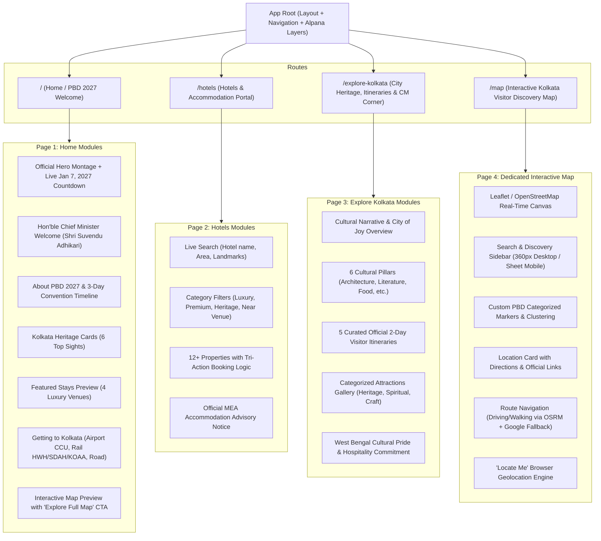

# 19th Pravasi Bharatiya Divas 2027 – Kolkata Welcome & Visitor Experience Portal
## Comprehensive Master Implementation Plan & Architectural Blueprint

> **Event Summary**: 19th Pravasi Bharatiya Divas Convention  
> **Dates**: January 7–9, 2027  
> **Location & Venue**: Kolkata, West Bengal | Biswa Bangla Mela Prangan  
> **Official Theme**: *"Return to Roots: Reigniting the Diaspora Connect with Bharat"*  
> **Primary References**:  
> - Official PBD Portal: `https://pbdindia.gov.in/`  
> - Uploaded Reference Banner: `media_1795167555984_c9c93729.jpg`  
> - Interactive Map Reference: `https://www.durgapujakolkata.in/map`  
> - Cultural Asset Source: `C:\Users\santr\banglar-durgotsav-frontend\src\assets`  

---

## 1. Visual Identity & Reference Banner Analysis

### 1.1 Direct Analysis of the Uploaded Reference Image
The uploaded official banner establishes the visual benchmark:
1. **Left Visual Composition (approx. 55% width)**:
   - **Howrah Bridge**: Iconic cantilever steel bridge over the river Hooghly.
   - **Rabindranath Tagore**: Distinguished portrait statue representing Bengal's literary and philosophical soul.
   - **Heritage Tram & Classic Yellow Ambassador Taxi**: The unmistakable symbols of Kolkata's living transit heritage.
   - **Street Lamp & Heritage Signboard**: Warm nostalgic street corner aesthetics.
   - **Cultural Still Life**: Morning tea/chai in a traditional earthen cup (*bhaar*), hot *rasgullas* in a clay bowl, books, fresh jasmine garland, and a traditional white Bengali silk saree with red border (*Laal-Paar saree*).
2. **Right Typographic Section (approx. 45% width)**:
   - **Title Accent**: Flowing calligraphic script *"Kolkata"* in warm saffron/terracotta (`#D94B12`).
   - **Main Heading**: Bold, dignified serif/sans *"19th Pravasi Bharatiya Divas"* in deep maroon/brown (`#63240F`).
   - **Official Description**: Clear, crisp lead paragraph explaining the biennial diaspora convention and the official 2027 theme.
   - **CTA Button**: Clean white card button with burnt orange border (`border-[#D94B12]`), reading *"Know More"*.
3. **Upper-Right Cultural Emblem**:
   - Sacred, artistic Maa Durga face illustration with golden crown (*mukut*), radiating warmth and protection.
4. **Atmospheric Background Artwork**:
   - Intricate pale Bengali Alpana mandalas in soft peach/white (`#F5E7DA`), seamlessly watermarked into an ivory-white background.

### 1.2 Strict Colour Tokens
| Token | Hex | Role in UI |
| :--- | :--- | :--- |
| **PBD Saffron / Burnt Orange** | `#D94B12` | Script headings, active pills, countdown highlights, CTA accents, map marker pins |
| **Deep Maroon / Terracotta** | `#63240F` | Main editorial titles, section headings, high-importance badges |
| **Warm White Canvas** | `#FFFFFF` | Card surfaces, modal sheets, map controls, clean reading backgrounds |
| **Soft Ivory** | `#FAF5EF` | Page background, alternating section containers |
| **Decorative Pale Peach** | `#F5E7DA` | Alpana background vector fills, decorative divider borders |
| **Charcoal Typography** | `#333333` / `#414141` | High-legibility body text, technical specs, transit schedules |
| **Golden Zari Trim** | `#C89234` | Traditional ornamental borders and framing |

---

## 2. System Architecture & 4-Route Sitemap



---

## 3. Dedicated Interactive Map Architecture (`/map`)
*Inspired by `https://www.durgapujakolkata.in/map` and customized for international diaspora visitors.*

### 3.1 Map Engine & Technology
* **Map Engine**: Leaflet + React Leaflet with OpenStreetMap tiles (`https://{s}.tile.openstreetmap.org/{z}/{x}/{y}.png`).
* **Coordinates Anchor**: Kolkata Center `[22.5726, 88.3639]`, Biswa Bangla Mela Prangan `[22.5448, 88.3995]`.
* **Marker System**:
  - Custom SVG icons tinted with PBD Saffron (`#D94B12`) and Maroon (`#63240F`).
  - Distinct iconography for:
    - 🏛️ Convention Venue (*Biswa Bangla Mela Prangan*)
    - 🏨 Hotels & Resorts (*ITC Royal Bengal, JW Marriott, etc.*)
    - 🕌 Tourist & Heritage Attractions (*Victoria Memorial, Howrah Bridge, etc.*)
    - ✈️ Airport (*Netaji Subhas Chandra Bose International Airport - CCU*)
    - 🚆 Railway Stations (*Howrah, Sealdah, Kolkata Station*)
    - 🚌 Major Transport & Transit Hubs

### 3.2 Key Map Capabilities
1. **Unified Search & Auto-Suggest**:
   - Search across hotels, heritage sites, transit terminals, and convention facilities.
   - Instantly pans and zooms (`flyTo`) to the matched coordinates.
2. **Category Filter Chips**:
   - `All`, `Convention`, `Hotels (5-Star & Premium)`, `Tourist Sights`, `Historical Sites`, `Railway Terminals`, `Airport`, `Transit Hubs`.
3. **Interactive Location Detail Panel**:
   - Location name, category badge, verified photograph, distance from Biswa Bangla Mela Prangan.
   - Action buttons: *View Details*, *Get Directions (Plot Route)*, *Open in Google Maps*, *Visit Official Website*.
4. **Route Planning & Distance Calculation**:
   - Origin-to-destination route plotting using OSRM routing service with direct fallback to Google Maps directions.
   - Accurate distance calculations via Haversine formula.
5. **Geolocation ("Locate Me")**:
   - One-click browser geolocation centering the map on the delegate with visual pulsating blue radar pin.
6. **Mobile & Tablet Optimization**:
   - Desktop: Persistent left sidebar (360px) + full-screen map.
   - Mobile: Fullscreen map + floating top search + scrollable category pills + swipeable bottom sheet for location details.

---

## 4. Cultural Assets & Decorations Integration

From `C:\Users\santr\banglar-durgotsav-frontend\src\assets`:
* **Alpana Patterns**:
  - `svgs/alpona.svg`, `alpona-2.svg`, `alpona-btm.svg`, and `alpana/hero-alpana.png`.
  - Displayed with gentle CSS rotation (120s ambient cycle) and 8%–12% opacity behind the hero, CM welcome, and section transitions.
* **Floating Flowers**:
  - `flowers/1.png` through `flowers/7.png`.
  - Non-intrusive DOM particle effect with subtle vertical floating, gentle drift, and reduced-motion detection.
* **Hooghly River Element**:
  - `common/river.png` incorporated into riverside vignettes.
* **Reference Banner**:
  - The uploaded `media_1795167555984_c9c93729.jpg` is preserved and integrated directly into the Hero composition.

---

## 5. Detailed Page Breakdown & Functionality

### 5.1 Page 1: Home / Landing Page (`/`)
1. **Sticky Header**:
   - Official PBD 2027 identity + West Bengal cultural emblem + "Kolkata Welcomes the Diaspora".
   - Navigation: *Home*, *About PBD*, *Explore Kolkata*, *Hotels & Stays*, *Interactive Map*, *Chief Minister's Welcome*.
   - Primary CTA: *Explore Kolkata* (`/explore-kolkata`).
2. **Hero Section (55% / 45% Split)**:
   - **Left**: Authentic cultural composition featuring Howrah Bridge, Victoria Memorial, heritage tram, yellow taxi, Hooghly river, Rabindranath Tagore motif, and Maa Durga emblem.
   - **Right**:
     - Terracotta script: *"Kolkata"*
     - Main heading: *"19th Pravasi Bharatiya Divas 2027"*
     - Subtitle: *"Return to Roots: Reigniting the Diaspora Connect with Bharat"*
     - Venue & Dates: *Biswa Bangla Mela Prangan, Kolkata, West Bengal | January 7–9, 2027*
     - **Live Countdown Timer**: Real-time ticker counting down to January 7, 2027, 09:00 AM IST.
     - Dual CTAs: *Explore Kolkata* & *Discover Hotels*.
3. **Hon'ble Chief Minister Welcome**:
   - Official portrait of **Shri Suvendu Adhikari**, Hon'ble Chief Minister of West Bengal, encased in a decorative terracotta border with Alpana corner accents.
   - Welcoming greeting to global Indian diaspora delegates with an editorial note (*"Draft copy pending government protocol"*).
4. **About the Convention & 3-Day Timeline**:
   - Background on Pravasi Bharatiya Divas (commemorating Mahatma Gandhi's return on Jan 9, 1915).
   - Three-Day Timeline:
     - **Jan 7**: Youth Pravasi Bharatiya Divas.
     - **Jan 8**: Inauguration by Hon'ble Prime Minister of India & plenary sessions.
     - **Jan 9**: Valedictory Session & Pravasi Bharatiya Samman Awards by Hon'ble President of India.
5. **Kolkata Highlights Preview**:
   - 6 cards: Victoria Memorial, Howrah Bridge, Dakshineswar Kali Temple, Belur Math, Prinsep Ghat, Jorasanko Thakur Bari.
6. **Featured Hotels Preview**:
   - 4 closest luxury hotels to Biswa Bangla Mela Prangan (ITC Royal Bengal, JW Marriott, Hyatt Regency, Novotel) with direct links.
7. **Getting to Kolkata (Transit Cards)**:
   - Airport (CCU), Railway Terminals (Howrah, Sealdah, Kolkata Station), Road corridors (EM Bypass, Maa Flyover).
8. **Interactive Map Preview**:
   - Interactive preview widget showcasing key markers with a prominent *Explore Full Interactive Map* CTA leading to `/map`.
9. **Footer**:
   - Official links, quick navigation, disclaimers, and Government of West Bengal references.

---

### 5.2 Page 2: Hotels & Accommodation Portal (`/hotels`)
1. **Interactive Search & Category Filters**:
   - Live query filter by name, area, and venue proximity.
   - Category filter pills: `All`, `Luxury (5-Star)`, `Premium`, `Boutique / Heritage`, `Near Convention Venue`.
2. **Hotel Directory (12+ Curated Stays)**:
   - *ITC Royal Bengal*, *JW Marriott Hotel Kolkata*, *Hyatt Regency Kolkata*, *Novotel Kolkata Hotel & Residences*, *The Oberoi Grand*, *Taj Bengal*, *The Lalit Great Eastern*, *The Park Kolkata*, *Kenilworth Hotel*, *Raajkutir (IHCL SeleQtions)*, *The Westin Kolkata Rajarhat*, *Peerless Hotel*.
3. **Tri-Action Booking Logic (As Specified)**:
   - **Action 1 (Official Website)**: Verified direct official website URL.
   - **Action 2 (Find Booking Options)**: Formatted Google Search fallback:
     `https://www.google.com/search?q={HotelName}+Kolkata+official+booking`
   - **Action 3 (Directions)**: Direct Google Maps search link:
     `https://www.google.com/maps/search/?api=1&query={HotelName}+Kolkata`
4. **Mandatory Advisory Notice**:
   - Prominently informs delegates that official MEA special tariff partner hotels will be announced on the official PBD portal.

---

### 5.3 Page 3: Explore Kolkata (`/explore-kolkata`)
1. **City of Joy Narrative**:
   - Cultural history, literary legacy, and architectural renaissance.
2. **6 Cultural Pillars**:
   - Architectural Heritage, Art & Culture, Literature & Knowledge, Culinary Heritage, Spiritual Heritage, Modern Kolkata.
3. **5 Curated Official 2-Day Itineraries**:
   - *A Taste of Kolkata*, *City Heritage Walk*, *The Cultural & Literature Experience*, *Religious Tour*, *Shopping & Craft Trail*.
   - Each with morning, afternoon, evening timing breakdowns and direct route maps.
4. **Filterable Destination Gallery**:
   - Heritage, Spiritual, Riverside & Nature, Shopping & Crafts, Family & Science.
5. **Chief Minister Corner & West Bengal Hospitality**:
   - Cultural commitment to international delegates celebrating *"Atithi Devo Bhava"*.

---

### 5.4 Page 4: Dedicated Interactive Map (`/map`)
1. **Full-Featured Mapping Canvas**:
   - OpenStreetMap layer with custom PBD markers.
2. **Left Sidebar Panel**:
   - Search bar with live auto-filtering.
   - Category filter chips.
   - List of matching locations with distance to convention venue.
3. **Route Planner Widget**:
   - Origin selector (or current location) to destination selector.
   - Displays driving and walking routes with step summary and Google Maps backup.

---

## 6. Structured Data Layer Architecture

```text
src/
  data/
    event.ts          # Dates, venue, theme, 3-day timeline, official quotes
    hotels.ts         # 12+ properties with coordinates, categories, links
    attractions.ts    # 12+ destinations with descriptions, images, coordinates
    itineraries.ts    # 5 official 2-day itineraries with morning/aft/eve plans
    mapLocations.ts   # Unified GeoJSON-like points for map rendering & routing
    transport.ts      # Airport (CCU), 3 railway stations, road connectivity
```

---

## 7. Phased Implementation Roadmap

| Phase | Milestone | Scope |
| :---: | :--- | :--- |
| **Phase 1** | **Routing & Dependencies** | Install `react-router-dom`, `leaflet`, `@types/leaflet`. Configure PBD color tokens in `index.css`. |
| **Phase 2** | **Asset Organization** | Copy Alpana SVGs, flower PNGs, and reference banner into `src/assets/`. |
| **Phase 3** | **Data Stores** | Implement `event.ts`, `hotels.ts`, `attractions.ts`, `itineraries.ts`, `mapLocations.ts`. |
| **Phase 4** | **Global Layout & Animations** | Build `Header.tsx`, `Footer.tsx`, `AlpanaBackground.tsx`, `FloatingFlowers.tsx`, `Countdown.tsx`. |
| **Phase 5** | **Page 1: Home Implementation** | Build Hero (55/45), CM Welcome, PBD Overview, Highlights, Featured Hotels, Map Preview. |
| **Phase 6** | **Page 2: Hotels Implementation** | Build Search, Category Filters, 12+ Hotel Cards with Tri-Action Booking & Disclaimer. |
| **Phase 7** | **Page 3: Explore Kolkata** | Build 6 Cultural Pillars, 5 Curated Itineraries, Filterable Attractions, Cultural Corner. |
| **Phase 8** | **Page 4: Interactive Map** | Implement Leaflet OSM map, custom PBD markers, search sidebar, route planner, mobile bottom sheet. |
| **Phase 9** | **Testing & Production Build** | Verify all 4 routes, responsive viewports, TypeScript validation, and run `npm run build`. |

---

## 8. Confirmation & Next Step

This plan covers every instruction from your prompt and the reference banner.
Upon your confirmation, implementation will commence immediately starting with Phase 1.
